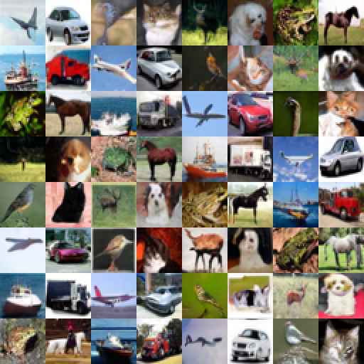
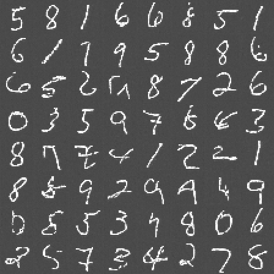

# PRISM
### _Probabilistic Reverse-diffusion for Image Synthesis with Multimodal guidance_
_Research project based on DDPM, DDIM and CFG papers._
PRISM is a research initiative aimed at understanding unconditional and guided diffusion models for image generation. The project replicates three foundational papers: DDPM for the core denoising framework, DDIM for faster deterministic sampling, and classifier-free guidance (CFG) for conditional control.
The replication is done on MNIST and CIFAR-10, following professional research practices: planning and tracking work in the open, fixed seeds and pinned dependencies for reproducibility, experiment tracking, and an honest comparison against the published results.
The conditional configurations use the dataset class label as the U-Net conditioning. During
training, `entrenamiento.p_uncond` randomly replaces a label with the reserved null class, so
the same model learns both conditional and unconditional predictions. During sampling,
`entrenamiento.guidance_scale` combines those predictions; a value of `1` disables guidance.
The developed models will be exposed in a web app that showcases the generation process: the initial full-noise state, the final denoised image, and the intermediate states in between. This makes it possible to see how the reverse-diffusion process gradually turns noise into structure, and to compare DDPM and DDIM sampling side by side.
Because the training hardware and budget are private and limited, training time has been cut relative to the original papers. As a result, absolute quality metrics (FID, IS) are expected to fall short of the published figures. Every deviation from the papers is documented in the sections below, along with its likely consequences, so that results can be interpreted fairly rather than compared naively.


[](LICENSE)
[](.github/workflows/ci.yml)
[](https://github.com/josuviteri/prism/releases)
[](https://github.com/josuviteri/prism/graphs/contributors)
[](https://github.com/josuviteri/prism/issues)
[Roadmap](#roadmap) | [Installation](#installation) | [Contributing](CONTRIBUTING.md) | [License](#license)
# References
Replication of **Jonathan Ho, Ajay Jain & Pieter Abbeel, 2020 ·  DDPM**, **Jiaming Song, Chenlin Meng & Stefano Ermon, 2021 · (DDIM)**, **Jonathan Ho & Tim Salimans, 2022 · (CFG)**, over **MNIST** and **CIFAR-10** datasets,
with a web UI for experimental guided generation on top.
- **[DDPM Paper](https://arxiv.org/pdf/2006.11239)**
- **[DDIM Paper](https://arxiv.org/pdf/2010.02502)**
- **[CFG Paper](https://arxiv.org/pdf/2207.12598)**
- **[Reference of DDPM Implementation](https://github.com/hojonathanho/diffusion)**
- **[Experiment Tracking: W&B](https://forge.coreweave.com/wandb/Viteritarrak/PRISM)**
- **Authors:** **[Josu Viteri](https://www.linkedin.com/in/josu-viteri/)** & **[Gotzon Viteri](https://www.linkedin.com/in/gotzonviteri/)**
## Decisions Papers Didn't Specify

- **Evaluation labels:** class-conditional checkpoints are evaluated with balanced labels (cycling through the dataset classes) by default. `--sin-etiquetas` preserves the previous behaviour, sampling with the null class only.
- **Classifier-free guidance:** CFG is only available for checkpoints trained with `entrenamiento.p_uncond > 0`. `--guidance-scale` overrides the scale used at evaluation; `w = 1` does not amplify guidance.
- **Unconditional checkpoints:** label selection does not affect unconditional models.

## Results
| Best Model ID | Training Steps | Denoising Method | Dataset | FID (lower is better) | IS (higher is better) |
|---|---|---|---|---|---|
| Original DDPM | 800k | DDPM |Complete CIFAR-10 Test Set | 3.17 | 9.46 |
| mnist_ddpm_v0.2 | 38.6k | DDPM | Complete MNIST Test Set | NA | NA |
| mnist_ddpm_v0.2 | 38.6k | DDIM | 2k sample subset from MNIST Test Set | 31.93 | 2.13 |
| mnist_ddpm_v0.2 | 38.6k | DDIM | Complete MNIST Test Set | 31.34 | 2.14 |
| cifar_ddpm_v0.3 | 45.7k | DDPM | Complete CIFAR-10 Test Set | NA | NA |
| cifar_ddpm_v0.3 | 45.7k | DDIM | 2k sample subset from CIFAR10 Test Set | 59.09 | 6.49 |
| cifar_ddpm_v0.3 | 45.7k | DDIM | Complete CIFAR-10 Test Set | **41.24** | **6.94** |
| guided_mnist_ddpm_v0.1 | 70.3k | DDIM, labels + CFG | Complete MNIST Test Set | Under review | Under review |
| guided_mnist_ddpm_v0.1 | 70.3k | DDPM | Complete MNIST Test Set | NA | NA |
| guided_cifar_ddpm_v0.1 | 52.7k | DDIM, labels + CFG (`w = 2`) | Complete CIFAR-10 Test Set | **36.04** | **8.28** |
| guided_cifar_ddpm_v0.1 | 52.7k | DDPM | Complete CIFAR-10 Test Set | NA | NA |

Class-conditional checkpoints are now evaluated with class-balanced labels and CFG when the checkpoint was trained with `p_uncond > 0`. Earlier metric-script runs sampled using the null class only; use `--sin-etiquetas` to reproduce that behaviour. The unconditional CIFAR-10 checkpoint gives the same result with or without this flag (FID 41.2357, IS 6.9424).

### Guidance-scale sweep (DDIM, 50 steps, complete test set)

**CIFAR-10 — `guided_cifar_ddpm_v0.1`**

| Sampling | FID (lower is better) | IS (higher is better) |
|---|---:|---:|
| Null class only (previous behaviour) | 42.62 | 6.72 |
| Labels, `w = 1` | 38.63 | 7.33 |
| Labels, `w = 2` | **36.04** | 8.28 |
| Labels, `w = 3` | 38.99 | 8.50 |
| Labels, `w = 5` | 43.98 | 8.64 |

For this checkpoint, IS increases across the tested guidance scales, while FID is lowest at `w = 2`. This is the best result among the tested values, not necessarily a global optimum. Since `w` was selected using the same test set, the comparison has some selection bias.

**MNIST — `guided_mnist_ddpm_v0.1`** (metrics computed with the project's LeNet evaluator, not Inception)

| Sampling | FID | IS |
|---|---:|---:|
| Null class only (previous behaviour) | 34.34 | 2.16 |
| Labels, `w = 1` | 37.35 | 2.32 |
| Labels, `w = 2` | 53.03 | 1.55 |
| Labels, `w = 3` | 44.99 | 1.94 |
| Labels, `w = 5` | 33.31 | 2.30 |


Evaluating on the complete test set using the DDPM method takes much longer than doing it using DDIM. We have not included DDPM metrics yet due to the available compute budget.
## Architecture

U-Net


## Repository Map

```
configs/      Hyperparameters and configurations.
src/data/     Load, splits and transformations.
src/models/   Replicated architecture.
src/training/ Train loop and evaluation.
src/app/      Service layer: Loads checkpoints and answers.
scripts/      Data download and utilities.
tests/        Unit tests, invariance, linting and reproducibility.
run.py        Execution.
```
## Installation

```bash
git clone https://github.com/josuviteri/PRISM
cd PRISM
python -m venv .venv && source .venv/bin/activate    # Windows: .venv\Scripts\activate
pip install -r requirements.txt
```

## Usage

### Local Development Environment

NVIDIA RTX 5070 12GB
### Dataset Retrieval

```bash
python scripts/get_data.py # include --unzip argument to decompress after download
```

Downloads CIFAR10 and MNIST datasets, previously retrieved from official sources at <https://cave.cs.toronto.edu/kriz/cifar.html> and <https://www.kaggle.com/datasets/hojjatk/mnist-dataset> respectively. Verifies the SHA-256. 142,6MB compressed
CIFAR10 License: MIT
MNIST LICENSE: CC BY-SA 3.0


### Execution

```bash
# Smoke test.
python run.py --smoke
# Unconditional DDPM training over local CIFAR10 IDX.
python run.py --config configs/cifar10.yaml

# Unconditional DDPM training over local MNIST IDX.
python run.py --config configs/mnist.yaml

# Class-conditional DDPM + classifier-free guidance (CIFAR-10).
python run.py --config configs/guided_cifar10.yaml

# Class-conditional DDPM + classifier-free guidance (MNIST).
python run.py --config configs/guided_mnist.yaml
# Improved LeNet CNN for MNIST dataset IS and FID metric evaluations.
python run.py --config configs/mnist_evaluator.yaml

# Start the web app through the project entry point.
python run.py --serve

# Calculate metrics and log FID/IS to W&B. Paths and sampling options live in the config.
python run.py --solo-metricas --config configs/cifar10.yaml
python run.py --solo-metricas --config configs/mnist.yaml
# Generate images from gaussian noise using EMA weights.
python scripts/inference_diffusion_uncond.py --checkpoint checkpoints/model.pt \
	--output-dir generated --num-samples 64 --DDPM
    # use --DDPM or --DDIM + --denoising-steps --num-samples depending on desired reversing technique out of the web UI
```

**Evaluate directly from a checkpoint** (class-conditional checkpoints use balanced labels by default):

```bash
# CIFAR-10
python scripts/evaluate_diffusion_cifar10.py --checkpoint checkpoints/guided_cifar10_ddpm_v0.1.pt --DDIM
python scripts/evaluate_diffusion_cifar10.py --checkpoint checkpoints/guided_cifar10_ddpm_v0.1.pt --DDIM --guidance-scale 2
python scripts/evaluate_diffusion_cifar10.py --checkpoint checkpoints/guided_cifar10_ddpm_v0.1.pt --DDIM --sin-etiquetas

# MNIST (requires the LeNet evaluator checkpoint)
python scripts/evaluate_diffusion_mnist.py --checkpoint checkpoints/guided_mnist_ddpm_v0.1.pt --evaluator-checkpoint checkpoints/mnist_evaluator_v0.1.pt --DDIM --batch-size 512 --guidance-scale 1
```

Use `--guidance-scale W` to override the guidance scale, `--sin-etiquetas` to sample with the null class (legacy behaviour), and `--label C` in `inference_diffusion_uncond.py` to generate a specific class.

MNIST expects four uncompressed IDX files at `data/data/mnist`: `train-images.idx3-ubyte`, `train-labels.idx1-ubyte`, `t10k-images.idx3-ubyte` and `t10k-labels.idx1-ubyte`. Images are maintained in `28x28` with a single channel; normalization is calculated only with the train split.
Evaluation downloads weights from Inception-v3 first time and requires `torchvision`,
included at `requirements.txt`. For a fast check, try to reduce the cost of evaluation by using a subset from the test set; subsets smaller than the default 10,000 samples are selected with balanced class stratification.
### Reproducibility

- Seed utility at `src/utils/seed_demo.py`; seed values are set in `configs/`.
- Dependencies with exact versions at `requirements.txt`.
- Compute budget: **NVIDIA RTX 5070 12 GB**.
- What the paper stated but was cut and its consequences: We decide to cut the training steps and did not evaluate using DDPM for now due to computing time constraints (it could be done in next releases).

### Tests

```bash
pytest tests/ -q
```

The evaluation changes add tests for balanced sampling labels and CFG-scale validation in `tests/test_sampling_labels.py`.

## Contributing
## Roadmap
Long-range feature roadmap is susceptible to changes. What is planned and in progress is tracked in the open:
- **[Open issues](https://github.com/josuviteri/prism/issues)** - Planned work, accepted feature requests, and known gaps. Issues are triaged and labelled by maintainers.
- **[Releases](https://github.com/josuviteri/prism/releases)** - What actually shipped in each version, with notes generated from the merged pull requests on that release branch.
- **[Kanban Board](https://github.com/users/josuviteri/projects/4)** - Interactive view of current tasks, active development, and project milestones across different workflow stages.
## License
Licensed under the Apache License, Version 2.0; see [`LICENSE`](LICENSE). Third-party attributions are listed in [`NOTICE`](NOTICE) and in the per-component `NOTICE` files.
### Nested Third-Party Licenses
Some subdirectories contain vendored third-party code or bundled assets under their own license. Each is listed below with its license and the path to that license file:
| Subdirectory | License | License file |
|--------------|---------|--------------|
| `data/` (downloaded datasets) | CIFAR-10: MIT; MNIST: CC BY-SA 3.0 | Dataset terms are referenced in [`NOTICE.md`](NOTICE.md); no dataset license file is bundled |
| Python dependencies in [`requirements.txt`](requirements.txt) | Individual licenses listed in [`NOTICE.md`](NOTICE.md) | [`NOTICE.md`](NOTICE.md) |
## AI Usage

Documented at [`AI_USAGE.md`](AI_USAGE.md).
